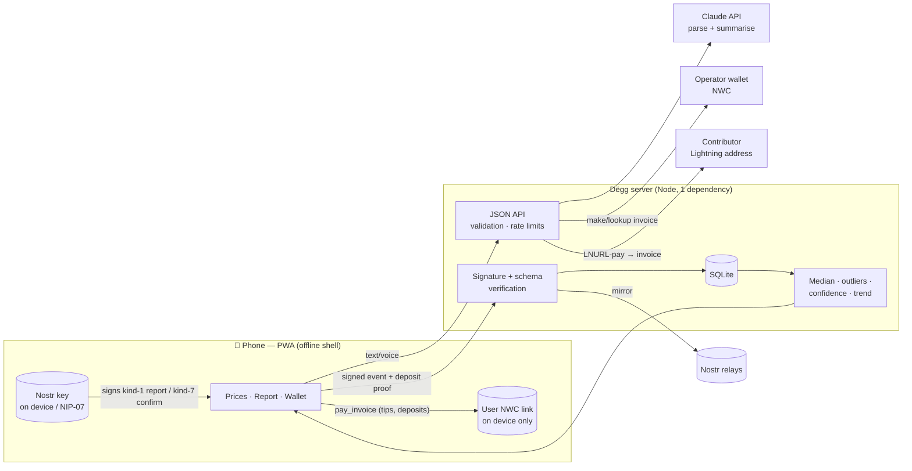

# Dëgg — the truth layer for African markets

> *Dëgg* means **truth** in Wolof.

Community-reported market prices for Senegal, **signed on Nostr**, **protected and rewarded with Bitcoin Lightning**, and made readable by **AI** — in French, Wolof and English, on a mid-range phone with a weak connection.

Built for the **Dakar Bitcoin Hack by BTrust** (2026).

---

## The problem

A shopper in Dakar who wants 25 kg of rice cannot easily know whether 12 000 XOF is fair. Prices vary between Sandaga, Tilène, Thiaroye and the neighbourhood boutique, change weekly, and are only shared by word of mouth. Travelling to compare costs time and transport money. Vendors with good prices have no simple way to advertise them.

## The solution

| You want to… | Dëgg does… |
|---|---|
| Know a fair price | Shows the **median price per market**, the range, how fresh the data is, the trend, and a **confidence score** |
| Find **any** food | Search in French, Wolof or English. 9 staple foods are built in; **any other food** (mangue, gombo, bissap…) can be added by the first person who reports its price, with the unit it's sold by (kilo, litre, piece, bunch, sack), and is then searchable by everyone |
| Get a price for **anything** | ~55 everyday foods have (DEMO) prices. For anything nobody has reported, Claude gives a rough Dakar price range in a dashed box labelled **"AI estimate · not verified"** — never stored as a report, never used in medians or confidence, cached 7 days. Needs `ANTHROPIC_API_KEY` |
| Report a price | Type or **speak** it ("soble 600 le kilo à Tilène"). AI extracts product, market and price per unit. **You check it, then sign it** |
| Trust a report | Every report is a **signed Nostr event** — inspect the raw event, the author key and timestamp. Others can **confirm** it (signed NIP-25 reaction) |
| Stop fake prices | Each report needs a tiny **Lightning deposit** (10 sats by default). Spam costs money. Big deviations from the median are **flagged**, not silently trusted |
| Reward good contributors | **Tip** a report in sats from your own wallet via **Nostr Wallet Connect**; payment proven by preimage |

**AI does not decide which price is true.** It parses messy language and writes summaries. Truth comes from signed reports, confirmations, and transparent statistics (median, outlier flags).

---

## Quick start (one command)

**Docker** (app + a local Nostr relay; provided but not yet tested by the team — `npm start` below is the verified path):
```bash
docker compose up --build
```
Open http://localhost:8080

**Without Docker** (Node 22.5+; uses Node's built-in SQLite):
```bash
npm install && npm start
```

That's it — it starts in **demo mode**: seeded demo data (every item badged **DEMO**), a demo wallet with fake sats, and demo deposit invoices that settle instantly. No keys or money needed.

Run the tests:
```bash
npm test
```

### Going live (all optional) — copy `.env.example` to `.env`
| Variable | Effect |
|---|---|
| `ANTHROPIC_API_KEY` | Claude parses French/Wolof reports, writes summaries, and gives labelled price estimates for unreported foods (otherwise rule-based parser, no estimates) |
| `GEMINI_API_KEY` | **Free alternative**: a Google Gemini key from [aistudio.google.com/apikey](https://aistudio.google.com/apikey) (no card) enables the same AI features. Used only if no Anthropic key is set. Note: Google may use free-tier inputs to improve its models; Dëgg only sends public report text and food names |
| `NWC_URL` | Operator wallet (needs `make_invoice` + `lookup_invoice`) → **real** Lightning deposits |
| `RELAYS` | Mirror signed reports and confirmations to Nostr relays |
| `DEPOSIT_SATS`, `REQUIRE_DEPOSIT` | Anti-spam deposit size / switch |

Users connect **their own** wallet in the Wallet tab with an NWC link (Alby Hub, Phoenixd, Mutiny, Coinos…).

### Testing with real NWC wallets (no real money)
[Alby's NWC Faucet](https://faucet.nwc.dev) creates throwaway wallets with pretend sats that speak the real NWC protocol and have working Lightning addresses.

1. Create three wallets and keep them **outside** the repo:
   ```bash
   mkdir -p ../wallets && for w in operator reporter tipper; do curl -s -X POST "https://faucet.nwc.dev?balance=10000" > ../wallets/$w.txt; done
   ```
2. Put the operator link in `.env`: `NWC_URL=<contents of operator.txt>` → server now issues **real** deposit invoices.
3. Check the plumbing (balance, make/lookup/pay invoice, LNURL):
   ```bash
   npm run check:wallet
   ```
4. `npm start`, open the **Wallet** tab, paste `tipper.txt` → *Connect*. Report a price with the reporter's `lud16` as your Lightning address: the 10-sat deposit is paid automatically from your wallet. Then tap **⚡ Reward** on that report: sats go to the reporter's address, and the tip is counted only after the server checks the preimage.

Verified end-to-end on 2026-11-16: operator +10 sats per deposit, reporter +21 sats tip, tipper debited exactly, `sats_tipped` = 21.

For a full regtest node setup instead, use [Polar](https://lightningpolar.com) + Alby Hub.

### Happy path to demo (≈2 minutes)
1. **Prices** → tap *Onion*: median, cheapest/most expensive market, trend, confidence.
2. Tap **Castors** → see an **OUTLIER** report (+150 % vs median) — flagged, excluded from the median, still visible.
3. Expand **"View signed Nostr event"** → the raw, verifiable event.
4. **Report** → type `sac de riz 50 kg à 22 500 à Sandaga` → *Analyse* → it proposes **450 XOF/kg** → *Sign and publish* (deposit paid) → appears in Rice / Sandaga.
5. Tap **Confirm** and **⚡ Reward** on another report.
6. **Wallet** → your npub, wallet balance, network metrics.

---

## Architecture



**Nostr event format** (kind 1, so any Nostr client can read it):
```json
{ "kind": 1, "content": "sac de riz 50 kg à 22 500",
  "tags": [["t","degg-price"], ["product","rice"], ["market","sandaga"],
           ["price","450","XOF"], ["unit","kg"], ["lud16","awa@getalby.com"]] }
```
Confirmations are NIP-25 reactions: `kind 7, content "+", ["e", <report id>]`.

| Component | Files |
|---|---|
| HTTP server & API | `server.js` |
| Report validation, aggregation, outliers, confidence | `lib/reports.js` |
| AI + rule-based parser, summaries | `lib/ai.js` |
| Lightning: deposits, LNURL-pay, BOLT11 + preimage check | `lib/lightning.js` |
| NWC client (shared browser/server) | `public/nwc.js` |
| PWA | `public/` |
| Demo seed | `lib/seed.js` |

---

## Security by design

**Threat model**

| Threat | Mitigation |
|---|---|
| Fake / manipulated prices | Paid deposit per report; per-key rate limit (20/h); price sanity bounds per product; median (not mean) ignores outliers; >50 % deviations flagged; confidence weighs distinct reporters + confirmations |
| Forged or edited reports | Server verifies every Schnorr signature on a clean copy of the event; tampered events are rejected (tested) |
| Self-confirmation | Confirming your own report is rejected |
| Fake tips inflating reputation | Real tips count only with a **preimage whose SHA-256 equals the invoice's payment hash**; demo tips are stored and labelled separately |
| Spoofed demo data | Events tagged `demo` are refused via the API — only the seed script can create them |
| Wallet theft | User's NWC secret and Nostr key **never leave the phone**. Server never holds user funds. Operator NWC lives only in env vars, and should be a budget-limited, receive-only connection |
| Malicious LNURL server | HTTPS only, no redirects, 8 s timeout, amount bounds checked |
| XSS / injection | Strict CSP (`script-src 'self'`), all user text HTML-escaped, parameterised SQL only |
| DoS | 8 KB body limit, per-bucket rate limits on parse/deposit, input length caps |
| Path traversal | Static files restricted to `public/` (tested) |

**Privacy**: no accounts, emails or phone numbers. IP addresses are never stored or logged (rate limiting uses a truncated, in-memory bucket). Logs contain only route + error message — never request bodies. Users are warned not to include personal data in public reports.

---

## UX for low bandwidth & mid-range phones
- No framework: ~25 KB of app code + the nostr-tools bundle; **service worker** caches the shell and last-seen prices for offline use.
- Voice input (Web Speech API, `fr-SN`), large tap targets (≥44 px), system fonts, light/dark themes with accessible contrast.
- French by default, English toggle; product names shown in **Wolof** (Ceeb, Soble, Diwlin…).
- Plain-language errors, and the AI result is always shown for **review before signing**.

## Constraints & honest limitations
- **Demo data is illustrative, not real market prices.** It is badged DEMO everywhere and counted separately in metrics.
- Wolof speech recognition in browsers is weak; Wolof is supported in **typed** reports and product names. Voice works best in French.
- Product units are normalised (XOF per kg / L / piece / bunch / sack); haggled prices and quality differences are not modelled yet.
- Community-added foods are identified by name + unit, so "Mangue" and "Mangues" can become two entries. Names are restricted to letters, digits and simple punctuation (no HTML); a merge/moderation tool is a next-iteration item.
- A determined attacker with many keys and sats can still post; the deposit makes this costly and the median + flags limit the impact.

## Metrics to track
- Verified (non-demo) reports per week, per market
- Active contributors (distinct pubkeys) and markets covered
- Confirmations per report; share of reports flagged
- Sats tipped to contributors; deposits collected
- Median data freshness for the top 5 products
- *(After user research)* time saved per shopping trip — **we do not claim money saved until measured**

All of these except the last are live at `GET /api/stats` and shown in the Wallet tab.

## Next iteration
1. Pilot with 10 vendors and 30 shoppers at Sandaga and Tilène; replace demo data with real reports.
2. WhatsApp / USSD reporting bridge for vendors without smartphones.
3. Refund deposit + bonus when a report gets ≥3 independent confirmations (requires operator `pay_invoice`).
4. Wolof speech-to-text model fine-tuned on market vocabulary.
5. More products and cities (Thiès, Saint-Louis, Touba); Nostr-native reputation via web-of-trust.

---

## 3-minute pitch outline
1. **Problem (30 s)** — "Is 12 000 for this sack of rice fair?" Prices vary across markets, and only word of mouth tells you.
2. **Solution (90 s)** — Live demo: compare markets → report by voice → AI proposes a price per kg → sign → pay a 10-sat deposit → it appears with the raw signed event. Show the flagged outlier. Tip a contributor.
3. **Why Bitcoin + Nostr + AI (30 s)** — Nostr makes every price verifiable without trusting us. Lightning makes spam expensive and good reporting rewarded. AI removes the language barrier but never decides the truth.
4. **Impact & next steps (30 s)** — Metrics we track; Sandaga pilot; WhatsApp bridge.

## License
MIT — open source, as the hackathon requires.
